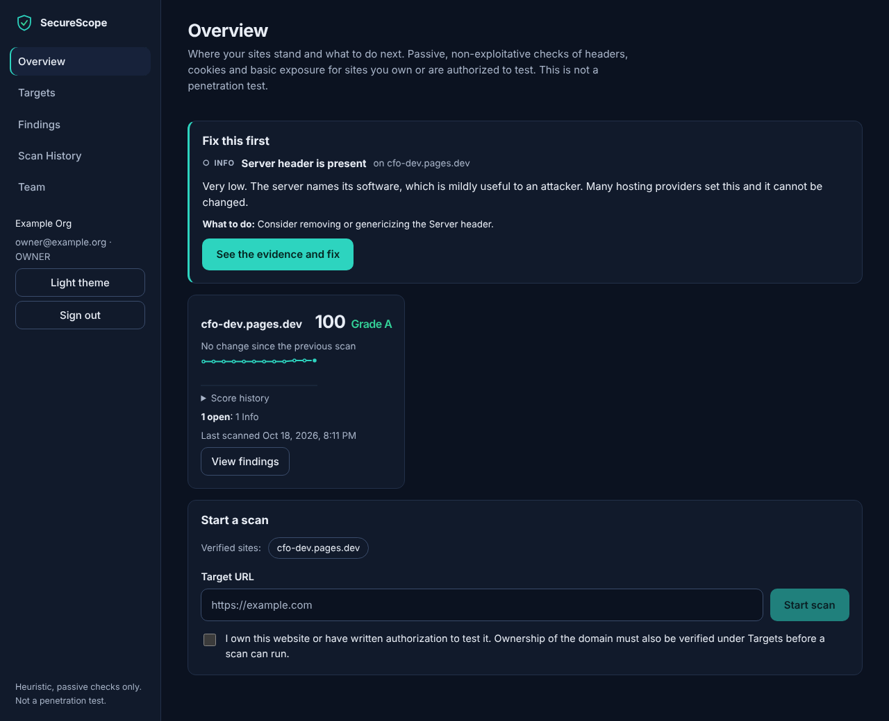
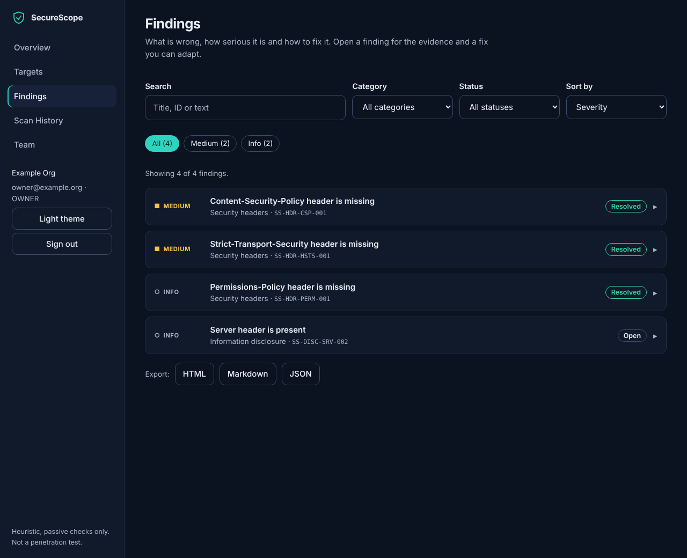
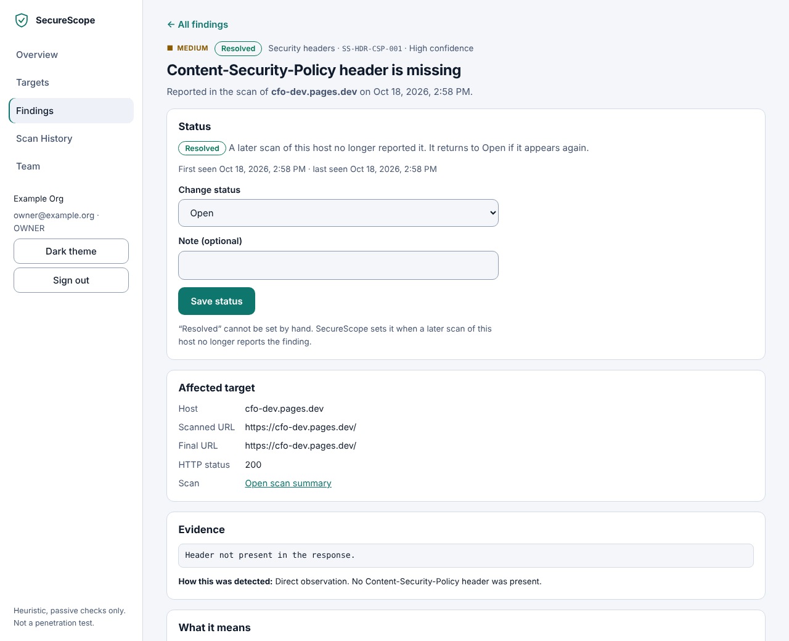
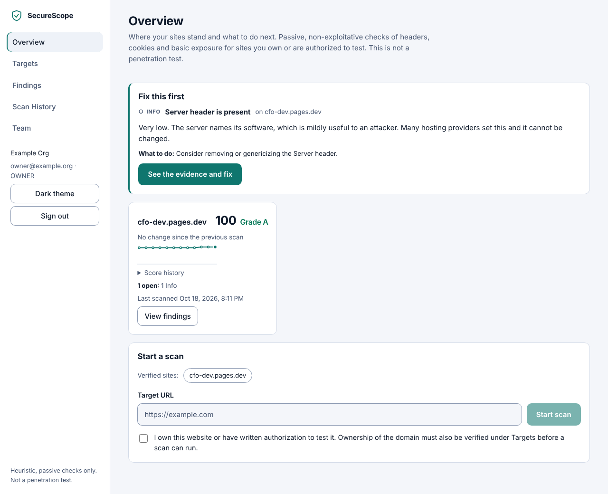

# SecureScope

[](https://github.com/franklinosuji2-afk/securescope/actions/workflows/ci.yml)

> **Status: v0.6.** Accounts, organizations, roles, tenant isolation and domain-ownership verification (DNS TXT / HTTP file) are implemented; scans only run against verified domains. Findings have a lifecycle (open, accepted risk, false positive, resolved) and the dashboard leads with what to fix first. Real email is **not** sent, so do not expose it publicly yet. See `docs/IMPLEMENTATION_PLAN.md`.

A passive web-application security **posture** scanner for sites you own or are authorized to test. It checks a handful of safe, non-exploitative signals, explains each finding with evidence and a fix, keeps scan history, and exports reports.

> **SecureScope is not a penetration test or a full vulnerability scanner.** A clean result is not proof of security. The score is a heuristic.

## Quick start

```bash
cp .env.example .env      # then edit POSTGRES_PASSWORD (PowerShell: Copy-Item .env.example .env)
docker compose up --build
# open http://localhost:8080 and create an account (use exactly this address: other origins are refused)
```

Requires Docker with Compose v2. No cloud account, no paid API. Data lives in PostgreSQL in a Docker volume; migrations run automatically on backend start.

## Screenshots

Captured from the running app against a real scan history of my own portfolio site (`cfo-dev.pages.dev`): it started at 80/B with four findings, and three were fixed and later marked **Resolved** by SecureScope when a newer scan no longer reported them. Account details are replaced with placeholders.

| Overview: what to fix first, score history | Findings with lifecycle status |
| --- | --- |
|  |  |

| Finding detail (light theme) | Overview (light theme) |
| --- | --- |
|  |  |

## What is implemented

| Area | Status |
|---|---|
| HTTPS usage and response metadata (status, content type, redirects, timing) | Implemented |
| Security headers: HSTS (HTTPS only), CSP, X-Content-Type-Options, Referrer-Policy, Permissions-Policy | Implemented |
| Disclosure headers: `Server` version detail, `X-Powered-By` | Implemented |
| Cookie attributes: `Secure`, `HttpOnly`, `SameSite` | Implemented |
| Conservative directory-index signature in the returned page | Implemented |
| Heuristic score and grade, severity breakdown, score history per site | Implemented |
| Evidence on every finding (URL, HTTP status, which headers were seen) and a per-finding confidence (`high` = observed, `medium` = heuristic) | Implemented |
| Finding lifecycle per organization and host: open, accepted risk, false positive (set by analysts, with a note), resolved (set only when a later completed scan no longer reports it). Failed scans never resolve anything | Implemented |
| Reports state what was checked, what passed and the limits of the scan | Implemented |
| Scan history, retention cleanup (default 30 days) | Implemented |
| Report export: HTML, Markdown, JSON | Implemented |
| Dashboard: Overview (guided setup, "fix this first", per-site posture and score history), Targets, Findings (filters, detail page with impact, evidence and fix), Scan History, Team | Implemented |
| Accessibility: light and dark themes, severity never shown by colour alone, keyboard-operable, automated axe checks in CI, mobile navigation menu | Implemented. No manual screen-reader testing yet |
| Domain targets with DNS TXT / HTTP-file ownership verification; scans refused for unverified hosts | Implemented. HTTP-file verification confirmed once end to end on a real domain; the DNS TXT path is tested with mocks only |
| Registration, login, logout, sessions (HttpOnly cookies + CSRF), Argon2id passwords | Implemented |
| Organizations, 5 roles enforced server-side, tenant-isolated scans, audit events | Implemented |
| Email verification / password reset flows | Implemented, but mail goes to the server log only |

## Roadmap (not implemented)

- Periodic re-verification of target ownership
- Real email delivery, audit-log read API, session management UI
- Scheduled rescans, scan cancellation, PDF reports
- Outdated-software detection, TLS configuration/certificate analysis, optional OWASP ZAP integration
- Egress proxy for production DNS-rebinding defence

## Safety model (enforced server-side)

- A scan needs a verified target for the exact host (DNS TXT or `/.well-known` file), plus an explicit authorization acknowledgement.
- Only `http`/`https` on ports 80, 443, 8080, 8443; no embedded credentials.
- Hostnames are resolved and every address must be globally routable; loopback, private, link-local, reserved and multicast are rejected.
- The scanner connects to the **validated IP** (DNS pinning, with correct Host/SNI), re-validating on every redirect. Only same-site redirects are followed; HTTPS→HTTP downgrades and off-origin hops are not followed and are reported.
- Limits: redirects, timeout, response size, requests per scan, scan duration, concurrent scans, per-client and per-target rate limits.
- No exploit payloads, brute force, credential attacks, port scans or off-origin crawling. Page bodies are never stored.
- Containers run as non-root with read-only filesystem and dropped capabilities; security headers on API and UI; strict CORS; pinned dependencies.

See [docs/THREAT_MODEL.md](docs/THREAT_MODEL.md), [docs/DATA_RETENTION.md](docs/DATA_RETENTION.md), [docs/KNOWN_LIMITATIONS.md](docs/KNOWN_LIMITATIONS.md) and [docs/RELEASE_CHECKLIST.md](docs/RELEASE_CHECKLIST.md).

## API

| Method | Path | Purpose |
|---|---|---|
| GET | `/api/v1/health` | Liveness |
| GET | `/api/v1/ready` | Readiness (database reachable) |
| POST | `/api/v1/scans` | Start a scan: `{"url": "...", "authorization_confirmed": true}` → 202 |
| GET | `/api/v1/scans?limit=&offset=` | List scans |
| GET | `/api/v1/scans/{id}` | Scan detail with findings |
| GET | `/api/v1/scans/{id}/report?format=json\|md\|html` | Export |
| GET | `/api/v1/overview` | Per-site posture: latest score, change, open findings, score history, what to fix first |
| PATCH | `/api/v1/findings/{fingerprint}` | Analyst triage: accepted risk, false positive, or reopen |

Scan endpoints require a signed-in user. Authentication, organization and member endpoints are in [docs/API.md](docs/API.md).

## Development

```bash
# backend
cd backend && python -m venv .venv && . .venv/bin/activate
pip install -r requirements-dev.txt
ruff check . && mypy app && pytest          # SQLite
# or on PostgreSQL:
SECURESCOPE_TEST_DATABASE_URL=postgresql+psycopg://user:pw@localhost:5432/test pytest
SECURESCOPE_DATABASE_URL=... python -m app.database.migrate
uvicorn app.main:create_app --factory --reload   # http://localhost:8000

# frontend
cd frontend && npm ci
npm run lint && npm run typecheck && npm test && npm run build
npm run dev                                       # http://localhost:5173, proxies /api to :8000
```

Tests need no internet: scanner integration tests run against a local mock server (the `SECURESCOPE_ALLOW_PRIVATE_TARGETS` switch exists only for that and must never be enabled in deployment).

Configuration is via `SECURESCOPE_*` environment variables; see `.env.example`.

## Layout

```
backend/   FastAPI app, scanner, SQLAlchemy/Alembic, tests (see docs/ARCHITECTURE.md)
frontend/  React + TypeScript + Vite dashboard, Vitest tests, nginx config
docs/      threat model, retention, limitations, release checklist
```

## Licence

Add a licence before publishing (none is chosen yet).
